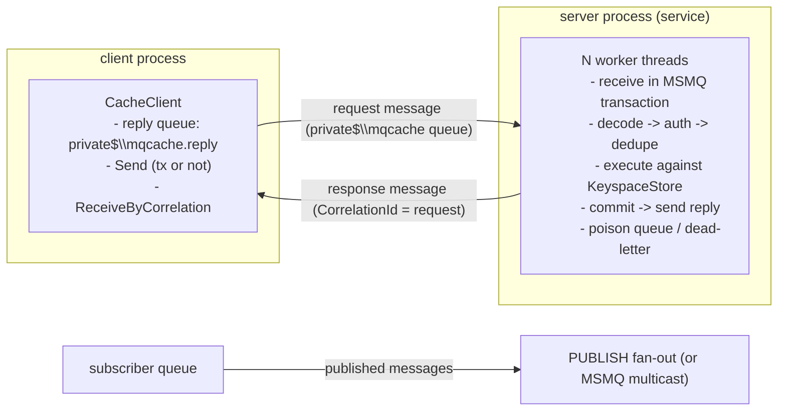

# Introduction

MQCache is an in-memory cache server with a Redis-like command set whose **transport is Microsoft Message Queuing (MSMQ)** instead of TCP sockets. It runs on Windows only, because MSMQ is a Windows technology.

| Component | Binary / package | Purpose |
|---|---|---|
| Server | `mqcache-server.exe` | Console app and Windows Service. Owns the in-memory keyspace. |
| CLI | `mqcache-cli.exe` | Interactive shell and one-shot runner (like `redis-cli`). |
| Client library | NuGet `MQCache.Client` | .NET API (`CacheClient`, `CacheSubscriber`). |
| Config | `mqcache.conf` | `redis.conf`-style configuration file. |

## Why MSMQ as a transport?

* **Durable, store-and-forward delivery.** A request survives a server restart: it waits in the queue until the server is back.
* **Transactions.** A request is received inside an MSMQ transaction; if processing fails it is redelivered.
* **Decoupling.** Clients and server do not need to be online at the same time, and the OS handles retries and routing.
* **Built-in Windows operations tooling.** Queue depth, journal, dead-letter queue and security are visible in Computer Management and Performance Monitor.

## Trade-offs (read this before adopting)

MSMQ is a message queue, not a socket. Expect **higher latency and lower throughput than Redis over TCP** (typically hundreds of microseconds to a few milliseconds per round trip, dominated by MSMQ, not by the cache). Use MQCache when you want Redis-style semantics inside a Windows/MSMQ estate; use Redis when you need raw speed.

Other deliberate limits:

* Messages are limited to **4 MiB** by MSMQ, so values are limited to **3.5 MiB** (default 1 MiB).
* No blocking commands (`BLPOP`, ...) and no `MULTI/WATCH`; use pipelines instead (see chapter 5).
* Single logical database, no clustering/replication. Scale by running several servers (different queue names).
* Only **private queues** and `DIRECT` format names are used, so Active Directory is not required.

## Architecture

1. The client creates a private **reply queue** `mqcache.reply.<pid>.<starttime>.<rand>` and removes it on dispose (orphans of crashed processes are swept at the next start).
2. A request message carries one or more commands, the client's password, a client-generated **request id** (idempotency key) and the reply queue as `ResponseQueue`.
3. A server worker receives it inside a `MessageQueueTransaction`, executes the commands and commits, then sends the response with `CorrelationId = request message id`.
4. The client uses **selective receive** (`ReceiveByCorrelationId`), so many threads can share one reply queue.

## Delivery semantics

| Situation | Behaviour |
|---|---|
| Server down | Requests wait in the queue (up to their TTL, default `timeout x (retries+1)`), then expire to the dead-letter queue. |
| Server crashes mid-request (transactional queue) | Transaction aborts, request is redelivered. |
| Request redelivered or client retries after a timeout | Same request id: the server returns the cached response instead of executing again (window `dedupe-window-seconds`). |
| Server restarts | Keyspace is restored from the last snapshot (see chapter 9); the dedupe cache is **not** persisted. |
| Reply lost / client gone | Reply expires after `reply-ttl-seconds`; no queue growth. |
| Poison message | After `poison-max-attempts` (or immediately when undecodable) it is moved to the poison queue and the client gets an error. |

> Cache semantics, not database semantics: data between snapshots is lost on a crash. Do not use MQCache as a system of record.
